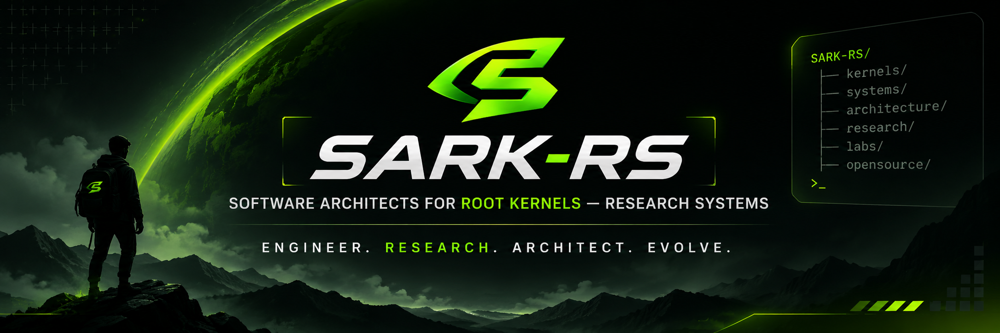

<div align="center">



### SOFTWARE ARCHITECTS FOR ROOT KERNELS — RESEARCH SYSTEMS

**ENGINEER. RESEARCH. ARCHITECT. EVOLVE.**

An independent engineering collective focused on foundational software architecture, kernel-level systems, low-level computing, and experimental research systems.

<br/>

**INDIA-BORN · GLOBALLY CONNECTED**

<br/>


</div>

---

## 01. ABOUT SARK-RS

**SARK-RS (Software Architects for Root Kernels – Research Systems)** is an independent technology and engineering collective established to explore, architect, develop, and experiment with foundational software systems.

Our interests extend beyond conventional application development into the deeper layers of computing, including operating system architecture, kernel engineering, systems programming, runtime environments, infrastructure, and experimental software platforms.

We aim to create an environment where developers, system architects, engineers, and researchers collaborate to understand how software systems work at their foundations and how they can be designed, optimized, and improved.

Our approach is grounded in three fundamental ideas:

- **Architecture:** Designing robust, scalable, and maintainable software systems.
- **Systems:** Understanding and engineering the underlying foundations of computing.
- **Research:** Experimenting with new approaches, technologies, and computational models.

> We believe exceptional software begins with a deep understanding of the systems beneath it.

---

## 02. WHAT DOES ROOT KERNELS MEAN?

The term **Root Kernels** represents our interest in the foundational layers of software and computing.

We use it as an engineering-oriented concept encompassing the core mechanisms and architectural foundations that allow software systems to operate.

Our technical interests include:

| Area | Focus |
|:---|:---|
| Operating System Kernels | Kernel architecture, processes, memory management |
| Systems Programming | Low-level programming, C, C++, Rust |
| Kernel Development | Kernel modules, system calls, device interfaces |
| Computer Architecture | CPU architecture, memory hierarchy, instruction execution |
| Runtime Systems | Virtual machines, interpreters, execution environments |
| Embedded Systems | Hardware-software interaction and resource-constrained computing |
| System Infrastructure | Networking, storage, scheduling, and resource management |

Our goal is to understand, experiment with, and contribute to the foundations that power modern computing.

---

## 03. RESEARCH SYSTEMS

Research Systems represents the experimental and investigative side of SARK-RS.

We are interested in exploring technical problems, developing prototypes, evaluating architectural approaches, and creating experimental implementations.

Potential research directions include:

- Experimental operating system components.
- Kernel-level programming and system utilities.
- Runtime and execution environments.
- Distributed computing architectures.
- Performance optimization and benchmarking.
- Memory management and resource allocation.
- Secure system architectures.
- Developer infrastructure and engineering tools.
- Experimental software platforms.

Research at SARK-RS should prioritize technical understanding, reproducibility, documentation, and measurable results.

---

## 04. ENGINEERING DOMAINS

Our broader engineering ecosystem encompasses multiple disciplines.

### 01 — Systems Engineering

Operating systems, kernels, networking, system programming, and computer architecture.

### 02 — Software Architecture

System design, architectural patterns, modularity, scalability, and reliability.

### 03 — Backend Engineering

API architecture, distributed services, microservices, databases, and server infrastructure.

### 04 — Application Engineering

Android, desktop, web, and cross-platform software development.

### 05 — Infrastructure Engineering

Linux, containers, CI/CD, automation, cloud infrastructure, and deployment systems.

### 06 — Security Engineering

Secure coding, system security, application security, and vulnerability research.

### 07 — Research & Development

Prototyping, experimentation, technical investigations, and proof-of-concept implementations.

---

## 05. TECHNOLOGY STACK

SARK-RS welcomes different programming languages and engineering technologies based on project requirements.

### Systems & Low-Level Development

`C` `C++` `Rust` `Assembly` `Linux` `POSIX`

### Software Engineering

`Java` `Kotlin` `Python` `Go` `JavaScript` `TypeScript`

### Backend & Infrastructure

`Spring Boot` `Node.js` `PostgreSQL` `MongoDB` `Redis` `Docker`

### Application Development

`Android` `Jetpack Compose` `React` `Next.js` `Flutter`

### Development & Automation

`Git` `GitHub Actions` `CMake` `Make` `GCC` `LLVM` `GDB`

*These technologies represent areas of interest and potential project tools, not a claim of official endorsement or active maintenance.*

---

## 06. RESEARCH & DEVELOPMENT PHILOSOPHY

We believe research should move beyond theoretical discussion into practical engineering.

Our preferred development approach follows this cycle:

```text
       IDENTIFY A PROBLEM
               |
               v
       TECHNICAL RESEARCH
               |
               v
       ARCHITECTURAL DESIGN
               |
               v
       EXPERIMENTAL DEVELOPMENT
               |
               v
       TESTING & BENCHMARKING
               |
               v
       TECHNICAL DOCUMENTATION
               |
               v
       REVIEW & IMPROVEMENT
               |
               v
       OPEN-SOURCE CONTRIBUTION
